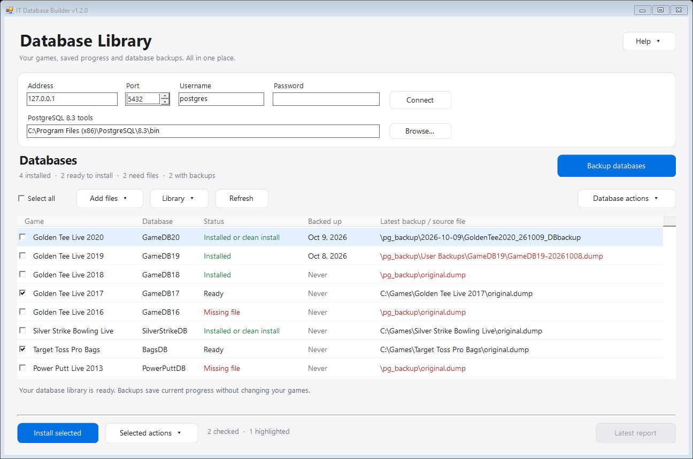
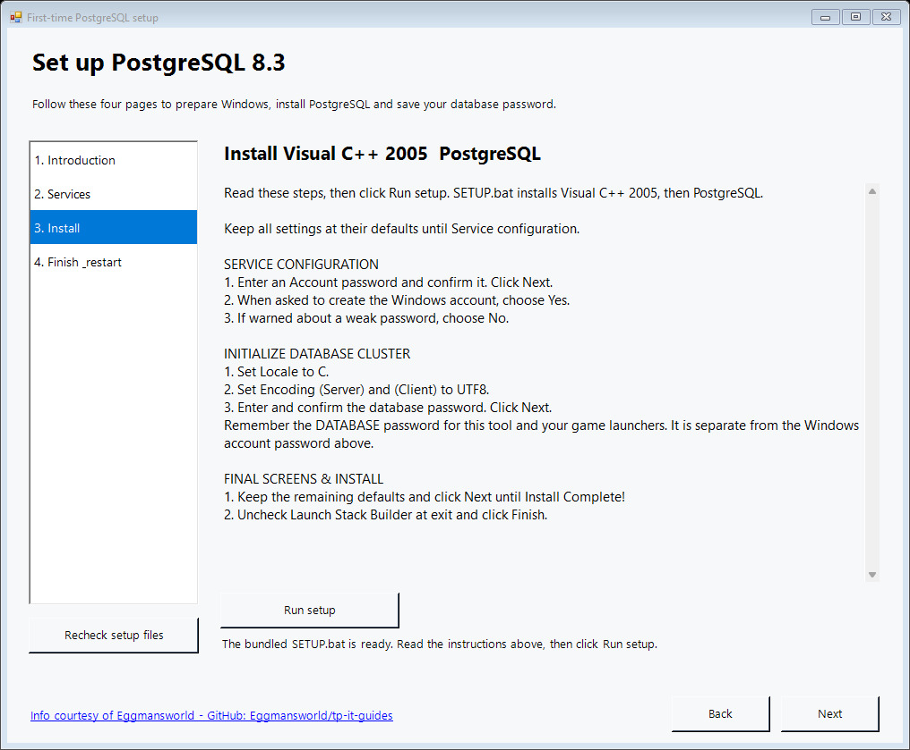
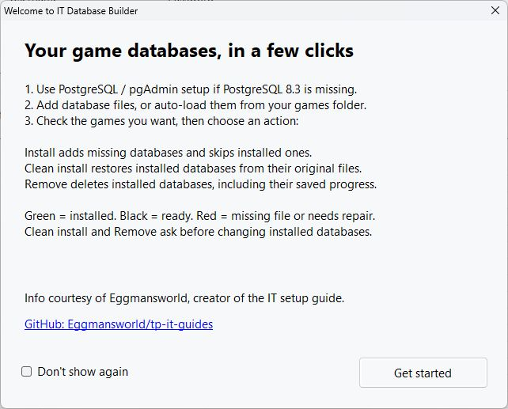

# IT Database Tool

A Windows app for setting up PostgreSQL 8.3 and managing Incredible Technologies game databases.

## Screenshots

Manage game databases and see which files are ready to install.

Follow the included PostgreSQL setup guide.

Review the basics from the welcome screen.

## Download and run

1. Download **IT-Database-Setup.zip** from [Releases](https://github.com/natemac/IT-Database-Tool/releases/latest).
2. Extract the whole ZIP and open **IT Database Builder.exe**.
3. If needed, use **PostgreSQL / pgAdmin setup** for the guided first-time installation.
4. Enter your database password and click **Connect**.
5. Add a database file or use **Auto-Find database files** to search your games folder.
6. Check your games and choose **Install**, **Clean install**, or **Remove**.

Game database files are not included. The app uses files where you select them, without copying, moving, or renaming them. Extract downloaded database archives first.

**Install** skips existing databases. **Clean install** requires confirmation and keeps the previous database as a recovery database. **Remove** requires confirmation and deletes the selected installed databases.

Your database connection and password are saved locally in `UserSettings.json`. New users start with a blank password. This private settings file is never included in downloads; keep your own copy private.

## Database list

`DatabaseInfo.json` is the editable game list. Use **Open Database List**, **Add game**, or **Edit game** in the app to maintain it. Updating this list leaves your connection and preferences in `UserSettings.json` unchanged. Install the matching updated app when upgrading from v1.0.0; existing connection fields migrate automatically. Updating this list leaves your connection and preferences in `UserSettings.json` unchanged. Install the matching updated app when upgrading from v1.0.0; existing connection fields migrate automatically.

The download includes the PostgreSQL 8.3 / pgAdmin III installer. PostgreSQL 8.3 is a legacy version for these games.

## Build from source

On Windows with .NET Framework 4:

1. Extract the release ZIP into the repository's `app` folder to supply the bundled installers.
2. In PowerShell run `./src/Build-ITDatabaseTool.ps1`.
3. The rebuilt app is in `app`; the shareable ZIP is in `output`.

Optional checks: `python src/test_auto_load_files.py` and `python src/test_bundled_installer.py`. They do not restore game databases.

## Credits

Info courtesy of [Eggmansworld](https://github.com/Eggmansworld/tp-it-guides), creator of the Incredible Technologies Super Easy Universal Setup Guide.

[Original guide and installer release](https://github.com/Eggmansworld/tp-it-guides/releases/tag/universal-guide). Third-party installers remain the work of their respective authors.
