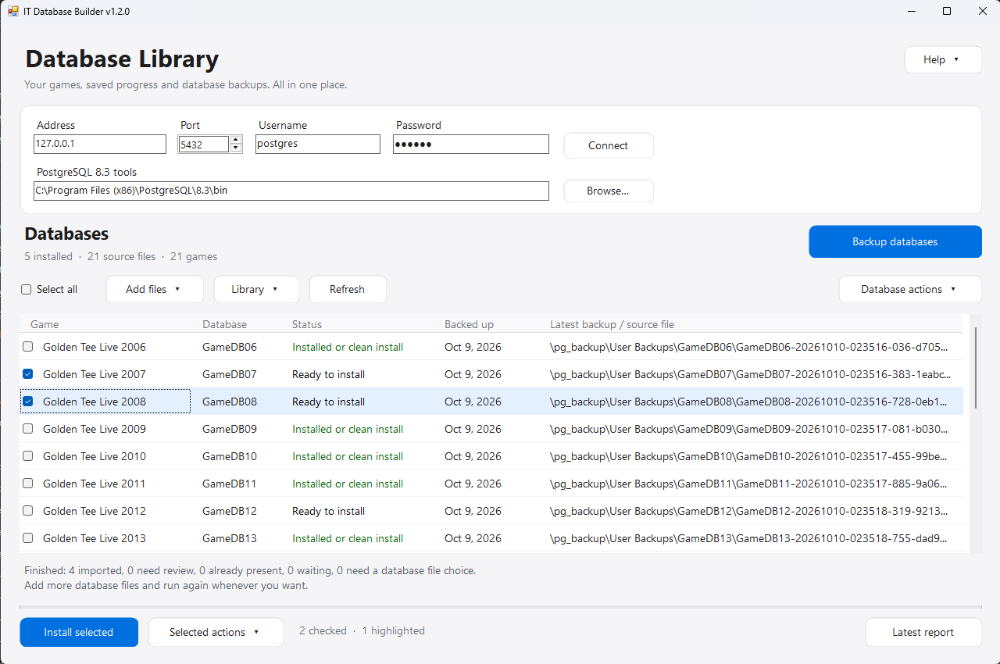
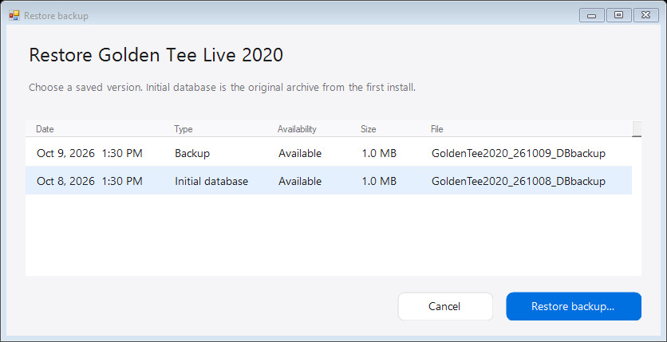
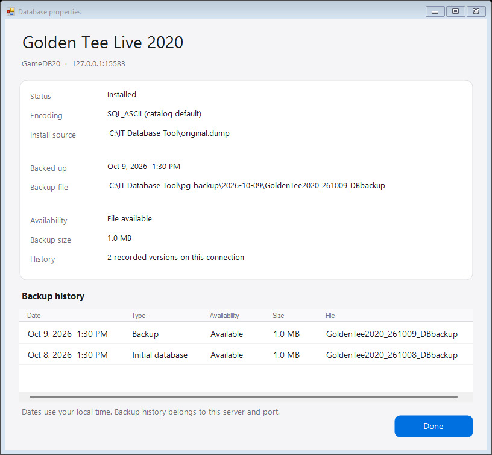

# IT Database Tool v1.2.0

A Windows app for setting up PostgreSQL 8.3 and managing Incredible Technologies game databases, saved progress and backups.

## Features

- Install and configure PostgreSQL 8.3.
- Find and import game database files.
- Install individual databases or batches.
- Back up all installed databases or selected games.
- Keep dated backups with multiple versions.
- Preserve the original database after its first installation.
- Restore any saved backup or the original database.
- View backup history and delete unwanted backups.
- Show database status, latest backup date and filename.
- Clean install or remove databases with confirmation.
- Manage games through right-click menus and Properties.
- Select multiple games using Ctrl/Shift.
- Save connection settings and preferences locally.
- View operation results and reports.

## Download and run

1. Download **IT-Database-Setup.zip** from [the latest release](https://github.com/natemac/IT-Database-Tool/releases/latest).
2. Extract the entire ZIP and open **IT Database Builder.exe**.
3. If PostgreSQL is missing, use **Help > PostgreSQL / pgAdmin setup**.
4. Enter your database password and click **Connect**.
5. Use **Add files** to select archives or Auto-Find them in your games folder.
6. Check games and click **Install selected**.

Game database archives are not included. Extract downloaded packs first. Add/Auto-Find remembers files in place; a successful first install separately copies its original archive into your backup folder.

## Your database library

Checkboxes control **Install selected** and **Selected actions**. Ctrl/Shift-click highlights rows for the right-click or **Database actions** menu. An action is greyed out unless every highlighted game qualifies. Row and file-column clicks only select rows. **Install** adds missing databases. **Clean Install from source** uses the **Install source** shown in Properties; the table displays the **latest backup**, falling back to the source when there is no backup history. The confirmation names the files it will use. **Remove** deletes installed databases and their saved progress after confirmation.

## Back up and restore

**Backup databases** saves every installed game. Use checked or highlighted actions for a smaller group. **Backed up** shows Never or the last backup date on the current connection. Backups use `pg_backup/YYYY-MM-DD/GameName_YYMMDD_DBbackup`, such as `pg_backup/2026-10-09/GoldenTee2020_261009_DBbackup`. Kept versions add `_2`, `_3`, and so on. If a backup exists, choose **Keep versions**, **Overwrite latest**, or **Cancel**. A selected restore source is protected from overwrite; keep another version instead. Right-click a game and choose **Restore backup** to select a saved version. **Initial database** identifies the original archive copied after its first successful installation.

Restoring an installed database requires confirmation and keeps its previous database as a recovery copy. Backups are verified before use; failed staged restores preserve the installed database. Close games and pgAdmin connections before restoring or removing databases. Properties lists each version, date, size, filename and availability. Right-click a history row to **Restore** or **Delete** it. Deletion asks first and removes that archive and history entry; the installed database and other versions remain.

A backup date is a snapshot, not continuous protection. Back up again to capture later progress. Keep an additional copy elsewhere if you need protection against loss of this computer.

## Settings and upgrades

`DatabaseInfo.json` holds the editable game list and selected source files. Use **Library > Add game**, right-click **Edit game**, or **Library > Open Database List**.

Connection fields, password, preferences and backup history stay locally in `UserSettings.json`. New users start with a blank password. Downloads exclude private settings, personal backups, reports and selected source paths/hashes.

When upgrading, close the app and keep your `UserSettings.json` and `pg_backup` folder. Keep your existing `DatabaseInfo.json` if it contains custom games or source selections. Older connection fields migrate automatically.

## Welcome and PostgreSQL setup

Welcome shows the app version and GitHub link, and can be reopened from **Help**.

The download includes the legacy PostgreSQL 8.3 / pgAdmin III installer used by these games. The setup guide walks through Services, installation, saving the database password and manually restarting Windows.

The library screenshot is user-provided; the other screenshots use example data.

## Build and checks

On Windows with .NET Framework 4, extract the release ZIP into `app` to supply the installers, then run `./src/Build-ITDatabaseTool.ps1` in PowerShell. It builds the EXE in `app` and the shareable ZIP in `output`.

Run `python src/test_auto_load_files.py` and `python src/test_bundled_installer.py` for discovery, settings, UI and packaging checks without changing game databases. The native suite additionally requires private PostgreSQL test runtime/archive fixtures and uses only an isolated temporary server on port 15583.

## Credits

Info courtesy of [Eggmansworld](https://github.com/Eggmansworld/tp-it-guides), creator of the Incredible Technologies Super Easy Universal Setup Guide. [Original guide and installer release](https://github.com/Eggmansworld/tp-it-guides/releases/tag/universal-guide). Third-party installers remain the work of their respective authors.
